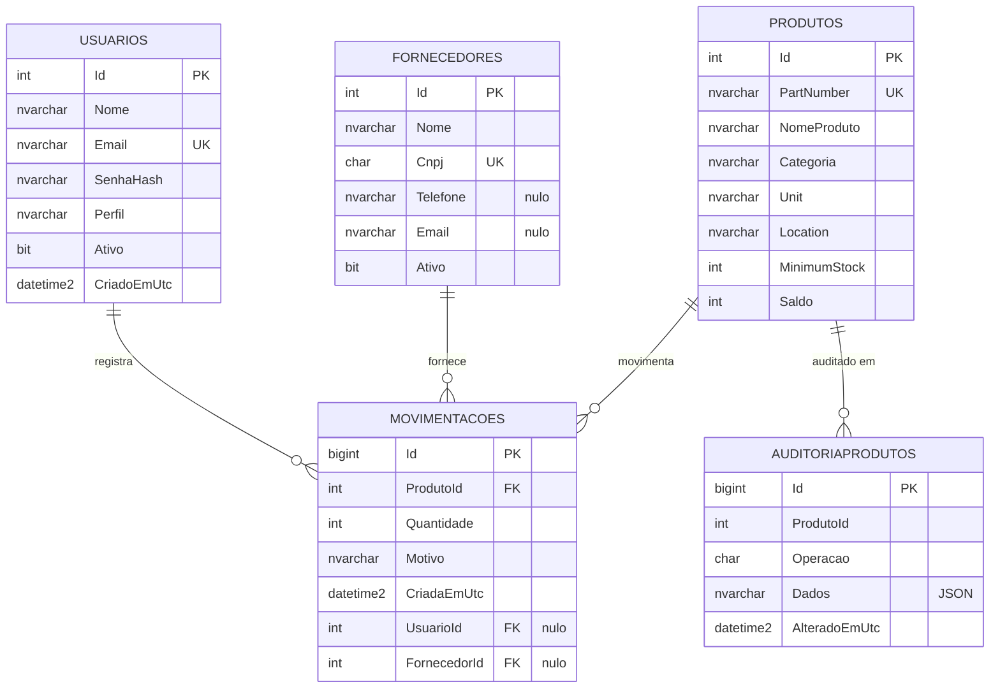

# Banco de dados — PIM Estoque (SQL Server)

Banco único usado pela API ASP.NET Core, pelo painel web e pelo app mobile. Regras definidas em `docs/CONTRATO_PIM_IV.md`.

| Arquivo | Conteúdo |
| --- | --- |
| `001_schema.sql` | Tabelas, PK/FK/UNIQUE/CHECK e índices |
| `002_triggers.sql` | `trg_Produtos_Auditoria`, `trg_Movimentacoes_Imutavel` |
| `003_procedures.sql` | `vw_SaldoPorCategoria` e as quatro procedures |
| `004_seed.sql` | Dados de demonstração (3 fornecedores, 12 produtos, 22 movimentações) |
| `entrega/pim_estoque_completo.sql` | Script completo para entrega: cria o banco `PimEstoque` e roda 001..004 (gerado por `entrega/gerar.ps1`) |
| `tests/validacao.sql` | Roteiro de testes para demonstrar no SSMS |
| `mer.json` | MER em JSON (usado para desenhar o diagrama no documento) |

Todos os scripts podem ser reexecutados: tabelas e índices só são criados se não existirem, triggers/procedures/view usam `CREATE OR ALTER` e o seed não duplica dados.

## Modelo lógico

- **Usuarios** (Id, Nome, Email, SenhaHash, Perfil, Ativo, CriadoEmUtc) — quem opera o sistema; perfil Administrador, Operador ou Consulta.
- **Fornecedores** (Id, Nome, Cnpj, Telefone, Email, Ativo) — origem das compras.
- **Produtos** (Id, PartNumber, NomeProduto, Categoria, Unit, Location, MinimumStock, Saldo) — itens do almoxarifado; `Saldo` é o estoque atual.
- **Movimentacoes** (Id, ProdutoId, Quantidade, Motivo, CriadaEmUtc, UsuarioId, FornecedorId) — histórico de entradas (+) e saídas (−).
- **AuditoriaProdutos** (Id, ProdutoId, Operacao, Dados, AlteradoEmUtc) — trilha de alterações do cadastro de produtos.

Relacionamentos:

- Produto 1 : N Movimentações (toda movimentação é de um produto).
- Usuário 0..1 : N Movimentações (quem registrou; opcional para cargas iniciais).
- Fornecedor 0..1 : N Movimentações (de quem veio a entrada; opcional em saídas).
- Produto 1 : N Auditoria — vínculo lógico, sem FK, para o registro sobreviver à exclusão do produto.

## MER



## Modelo físico

Tipos: `int IDENTITY` nas chaves de cadastro e `bigint IDENTITY` nas tabelas que só crescem (Movimentacoes, AuditoriaProdutos); `nvarchar` para texto com acentos; `char(14)` para CNPJ (tamanho fixo); `datetime2` em UTC (`SYSUTCDATETIME()`).

Restrições:

| Tabela | Restrição |
| --- | --- |
| Usuarios | `UQ_Usuarios_Email`; `CK_Usuarios_Perfil` (Administrador, Operador, Consulta) |
| Fornecedores | `UQ_Fornecedores_Cnpj`; `CK_Fornecedores_Cnpj` (14 dígitos, só números) |
| Produtos | `UQ_Produtos_PartNumber`; `CK_Produtos_PartNumber` (8 dígitos, prefixo 47/48/84/86); `CK_Produtos_Unidade` (UN, PC, PAR, CX, PCT, RL); `CK_Produtos_Minimo` e `CK_Produtos_Saldo` (0 a 999 999 999) |
| Movimentacoes | FKs para Produtos, Usuarios e Fornecedores (sem cascata: histórico nunca some); `CK_Movimentacoes_Quantidade` (≠ 0) |
| AuditoriaProdutos | `CK_AuditoriaProdutos_Operacao` (I, U, D); `CK_AuditoriaProdutos_Dados` (`ISJSON = 1`) |

Índices (além dos criados por PK e UNIQUE):

| Índice | Por quê |
| --- | --- |
| `UQ_Produtos_PartNumber` (da UNIQUE) | busca por part number |
| `IX_Produtos_NomeProduto` | busca e ordenação por nome |
| `IX_Produtos_Reposicao` (MinimumStock, Saldo) `WHERE MinimumStock > 0` | lista de reposição; o filtro ignora itens sem mínimo |
| `IX_Movimentacoes_ProdutoId_Id` | histórico de um produto em ordem de lançamento (API) |
| `IX_Movimentacoes_ProdutoId_CriadaEmUtc` INCLUDE (Quantidade) | extrato por produto e período |
| `IX_Movimentacoes_CriadaEmUtc` | movimentações do dia no painel |
| `IX_AuditoriaProdutos_ProdutoId` | consultar a auditoria de um produto |

## Triggers, procedures e view

| Objeto | Finalidade |
| --- | --- |
| `trg_Produtos_Auditoria` | AFTER INSERT/UPDATE/DELETE em Produtos: grava uma linha por produto afetado em AuditoriaProdutos com JSON `{"antes":{...},"depois":{...}}` (`FOR JSON PATH`). Não altera saldo. |
| `trg_Movimentacoes_Imutavel` | INSTEAD OF UPDATE, DELETE em Movimentacoes: `THROW 50010`. Erro de lançamento se corrige com estorno. |
| `sp_RegistrarMovimentacao(@ProdutoId, @Tipo, @Quantidade, @Motivo, @UsuarioId, @FornecedorId)` | Entrada (`'entrada'`) ou saída (`'saida'`) em transação; trava o produto com `UPDLOCK, HOLDLOCK`, recusa saldo insuficiente (`THROW 50002`), atualiza o saldo e grava a movimentação. Retorna `MovimentacaoId, SaldoAtual`. |
| `sp_ProdutosParaReposicao` | Itens com `MinimumStock > 0 AND Saldo <= MinimumStock`, com a quantidade em falta. |
| `sp_ResumoEstoque` | Indicadores do painel (total de produtos, itens em reposição, saldo total, movimentações de hoje) e saldo por categoria. |
| `sp_ExtratoProduto(@ProdutoId, @De, @Ate)` | Movimentações de um produto no período, com saldo após cada lançamento. |
| `vw_SaldoPorCategoria` | Produtos, saldo e itens em reposição por categoria. |

Erros da procedure: 50001 tipo inválido, 50002 saldo insuficiente, 50003 quantidade inválida, 50004 motivo vazio, 50005 produto não encontrado, 50006 saldo acima do limite.

Observação para a API: por causa da trigger AFTER em Produtos, o SQL Server recusa `INSERT/UPDATE ... OUTPUT` sem `INTO` nessa tabela. O EF Core precisa declarar `HasTrigger("trg_Produtos_Auditoria")` em Produto (e `HasTrigger("trg_Movimentacoes_Imutavel")` em Movimentacao, conforme o contrato).

## Como executar

**SSMS (entrega):** abrir `entrega/pim_estoque_completo.sql` e executar (F5). Ele cria o banco `PimEstoque`. Depois, para demonstrar, abrir `tests/validacao.sql` com o banco `PimEstoque` selecionado e executar: cada teste imprime OK/FALHA na aba Mensagens.

**sqlcmd:**

```sh
sqlcmd -S localhost -U sa -P "<senha>" -b -i database/entrega/pim_estoque_completo.sql
# ou, em um banco já criado, os scripts numerados em ordem:
sqlcmd -S localhost -U sa -P "<senha>" -d PimEstoque -b -i database/001_schema.sql,database/002_triggers.sql,database/003_procedures.sql,database/004_seed.sql
```

**docker-compose:** o serviço de inicialização deve criar o banco e rodar `database/0*.sql` em ordem alfabética **dentro dele** (os scripts numerados não têm `USE`):

```sh
sqlcmd -S sqlserver -U sa -P "$SA_PASSWORD" -b -Q "IF DB_ID('PimEstoque') IS NULL CREATE DATABASE PimEstoque"
for f in /database/0*.sql; do sqlcmd -S sqlserver -U sa -P "$SA_PASSWORD" -d PimEstoque -b -i "$f"; done
```

O `pim_estoque_completo.sql` fica em `entrega/` justamente para não ser executado de novo por esse laço.

**Regerar o script completo** depois de alterar 001..004: `powershell -File database\entrega\gerar.ps1`.

Os arquivos estão em UTF-8 com BOM, para o SSMS e o sqlcmd lerem os acentos corretamente.
